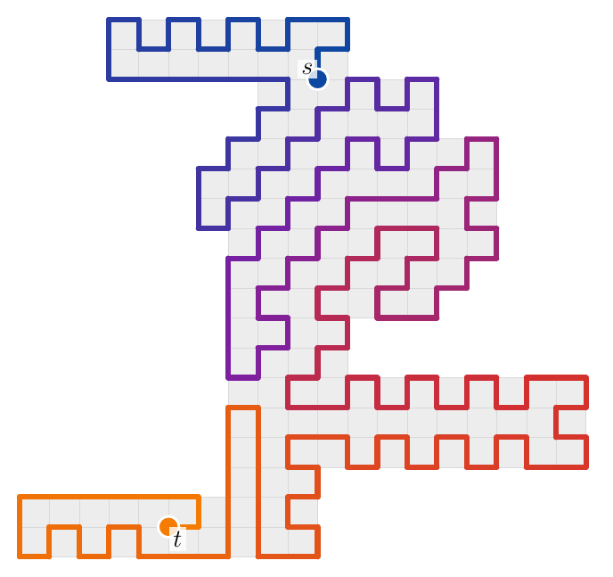

# Hamiltonian s–t paths in solid grid graphs, in Lean



A polynomial-time algorithm that decides whether a solid grid graph has a Hamiltonian path
between two given points, with a Lean 4 proof of its correctness and of a polynomial bound on
its step count.

A *grid graph* is a finite set of lattice points `V ⊂ ℤ²` with an edge between every two points
at distance 1. It is *solid* when it has no holes. Deciding Hamiltonian paths in solid grid
graphs was posed by Itai, Papadimitriou and Szwarcfiter (1982) and has been listed as open since.
The algorithm extends Sheffield's height-function algorithm for Hamiltonian cycles. Each endpoint
gets a *phantom* edge to a missing neighbour. An endpoint with all eight neighbours present
becomes a hole whose defect is a *vortex*, handled by a slit height and flip classes.

```lean
theorem SolidGridHam.HP.decideHamPath_main {V : Finset Pt} {s t : Pt}
    (hs : Solid V) (hst : s ≠ t) (hsV : s ∈ V) (htV : t ∈ V) :
    (decideHamPath V s t = true ↔ ∃ H, IsFactor V (dST s t) H ∧ ncomp V H = 1) ∧
      decideHamPathCost V s t ≤ 5220000 * (V.card + 3) ^ 6
```

`IsFactor V (dST s t) H` says that the edge set `H` has degree 1 at `s` and `t` and degree 2
everywhere else, and `ncomp V H = 1` says that it is connected. Together they say that `H` is a
Hamiltonian `s`–`t` path. `decideHamPath` is computable.

* No `sorry`. The main results use only `propext`, `Classical.choice` and `Quot.sound`.
* The build has no warnings.

The paper in [`paper/`](paper/) gives the algorithm, the proof, pseudocode and worked examples.


## What is proved

| Lean | Statement |
|---|---|
| `decideHamPath_main` | Correctness and the step bound, for every solid `V` and distinct `s, t ∈ V`. |
| `boundaryEndpoints_main` | Neither endpoint inner: correct, at most 1 060 000 (\|V\|+3)⁴ steps. |
| `oneHoleCase_main` | One endpoint inner: correct, at most 2 513 000 (\|V\|+3)⁵ steps. |
| `twoHoleCase_main` | Both endpoints inner: correct, at most 5 217 000 (\|V\|+3)⁶ steps. |
| `stuck_minimal` | The count behind the certificate for a stuck phase (with columns). |
| `ulhc_main` | Hamiltonian cycles (Umans–Lenhart): correct, at most 5·10⁸ (\|V\|+1)¹² steps; see below. |

An endpoint is *inner* when all eight of its king neighbours lie in `V`.

## What to check by eye

Lean checks everything except the following.

* **The definitions in the statement.** `Pt`, `Edge`, `IsEdge`, `deg`, `IsFactor`, `dST` and
  `Solid` (`lean/SolidGridHam/Basic/Grid.lean`) and `ncomp` (`Basic/Graph.lean`). `Solid` says
  that every missing point reaches the outside of `V` by king moves through missing points. It
  is cross-checked by computation against "every bounded face is a unit square"
  (`checks/solid_check.py`, `checks/solid_check_grid.py`), not proved equivalent in Lean.
* **The cost model of the path algorithm.** `decideHamPathCost` and the cost functions it calls
  are written beside the algorithm and follow its structure. Primitive operations on finite sets
  (membership, insertion, a cell flip) cost a constant. The correspondence between an algorithm
  and its cost function is checked by reading the two definitions side by side. The bound is
  not a Turing machine time bound.
* **Fixed endpoints.** The theorem is about paths between given `s` and `t`. Paths with free
  endpoints follow by trying all pairs.

The Umans–Lenhart part uses a different cost model. There the algorithm is written in a
step-counting monad, so its bound is about the steps of the algorithm itself, given the cost
table in `lean/SolidGridHam/Cycle/Timed/TimeM.lean` and the lint `checks/timed_lint.py`.

## Repository layout

* `lean/SolidGridHam/`: the formalization (Lean 4 and Mathlib, about 47,000 lines).
  * `Basic/`: grid graphs, factors, connectivity, arcs and heights. Every definition in the
    statement of the main theorem is here.
  * `Path/`: the s–t path development. `HPFinal.lean` has `decideHamPath_main`. The phase and
    the certificate are in `SPhaseAlg`, `PhaseS`, `ReduceS`, `Cert*` and `Minimal`, the phantoms in
    `TwoPh*`, the deletion walks in `TwoPhWalk*` and `HoleWalk*`, the vortices and slit heights in
    `SlitHeight` and `TwoVortex`, the class search in `HoleRelax` and `HoleTry`, and the starting
    factor in `FindFactor`. Lean names match the paper and its pseudocode. `Path/Prelim/` holds
    lemmas on path factors and notches that the development uses.
  * `Cycle/`: the Umans–Lenhart Hamiltonian cycle formalization that the path work builds on
    (`Main.lean` has `ulhc_main`), with the step-counting algorithm in `Cycle/Timed/`.
  * [`lean/README.md`](lean/README.md) describes the package.
* `paper/`: the paper (LaTeX). `make` builds `build/hpst.pdf`, and `make figures` regenerates the
  figures from the Python reference implementation.
* `lib/`: reference implementations, not verified.
  * `python/`: a reference mode that ports every definition of the algorithm with the same names,
    control flow and iteration orders, a fast mode, a command-line front end, a random instance
    generator and a brute-force checker.
  * `c/` and `js/`: ports of the fast mode, cross-checked against the Python implementation.
  * [`lib/README.md`](lib/README.md) documents the input format, the command lines and the tests.
* `demo/`: an interactive browser demo of the JavaScript implementation.
* `checks/`: cross-checks of `Solid`, sanity runs and the cost-model lint.
* `scripts/`: `check.sh` (release check) and `sanity.sh`.

## Building and checking

You need [elan](https://github.com/leanprover/elan). The toolchain (`lean/lean-toolchain`,
Lean v4.35.0-rc2) and Mathlib (`lean/lake-manifest.json`) are pinned.

```bash
cd lean
lake exe cache get
lake build
```

`lean/build.sh` wraps `lake build`. On a shared machine, `LEAN_MEM=12G LEAN_NUM_THREADS=2
lean/build.sh` caps memory and threads. A full build takes about half an hour on four cores.

```bash
scripts/check.sh
```

This builds with warnings treated as errors, prints the axioms of the main results
(`lean/CheckAxioms.lean`) and fails unless they are exactly `propext`, `Classical.choice` and
`Quot.sound`, and runs the cost-model lint.

## Running the algorithm

```bash
python3 lib/python/gen.py -n 60 --shape stamp | python3 lib/python/hpst_cli.py --draw
```

The input is an ASCII grid with `.` for points, `#` or a space for missing points, and `s`, `t`
for the endpoints. The output is `yes` and the path, or `no`. See [`lib/README.md`](lib/README.md)
for JSON input, the options, and the C and JavaScript command lines.

## [Demo](https://zzyzek.github.io/SolidGridGraphHamPath/demo)


A demonstration of the algorithm in a small [web app](https://zzyzek.github.io/SolidGridGraphHamPath/demo).

Generate a random solid shape, place `s` and `t` by
clicking, add or remove points, and press *solve*. The path is coloured from `s` (blue) to `t`
(orange).

To run locally:

```bash
cd demo
python3 -m http.server 8000
```

then open `http://localhost:8000/`.

## Sources

* A. Itai, C. H. Papadimitriou and J. L. Szwarcfiter, *Hamilton paths in grid graphs*, SIAM J.
  Comput. 11 (1982), 676–686.
* C. Umans and W. Lenhart, *Hamiltonian cycles in solid grid graphs*, Proc. 38th FOCS (1997),
  496–505.
* S. Sheffield, *Computing and sampling restricted vertex degree subgraphs and Hamiltonian
  cycles*, arXiv:math/0008231 (2000).

## AI disclosure

Nearly the entirety of the work for this project was done by Claude (Opus 5.5), including the
algorithm, the paper, the reference implementations in C, Python and JavaScript, the demo, and
the Lean 4 proof. I, the listed author, contributed little more than the problem statement and
guidance. I have listed myself as an author only to satisfy any requirement that a human author
be attached to this work.

## License

Everything in this repository is dedicated to the public domain under
[CC0 1.0 Universal](LICENSE), except two third-party files used by the demo, which keep their
own MIT licenses: `demo/js/two.js` (Two.js, © jonobr1) and `demo/css/skeleton.css` (Skeleton,
© Dave Gamache). Source files carry an `SPDX-License-Identifier: CC0-1.0` header.
